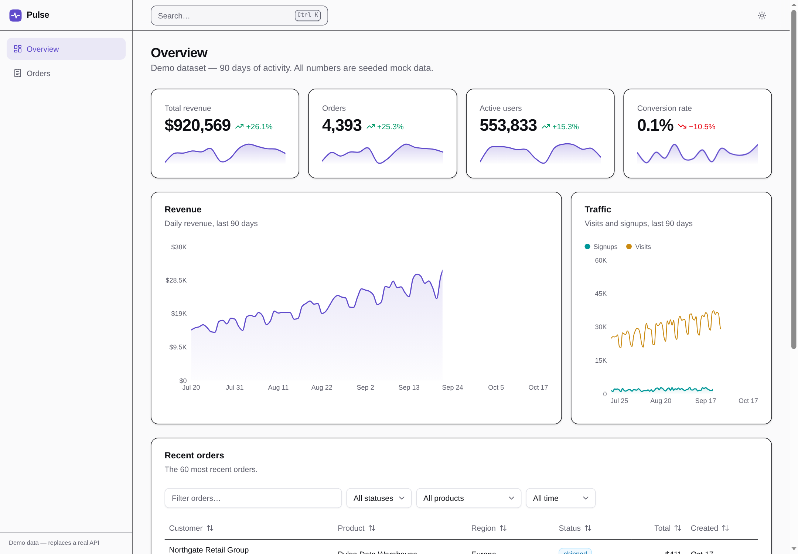
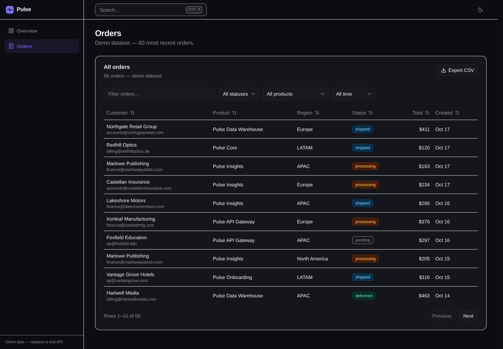
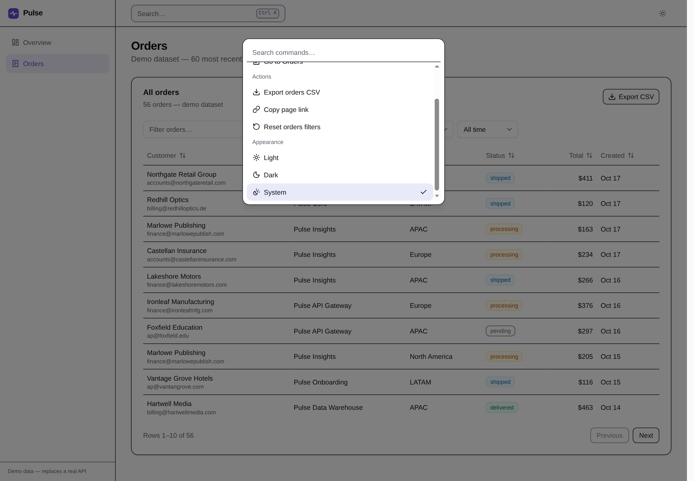
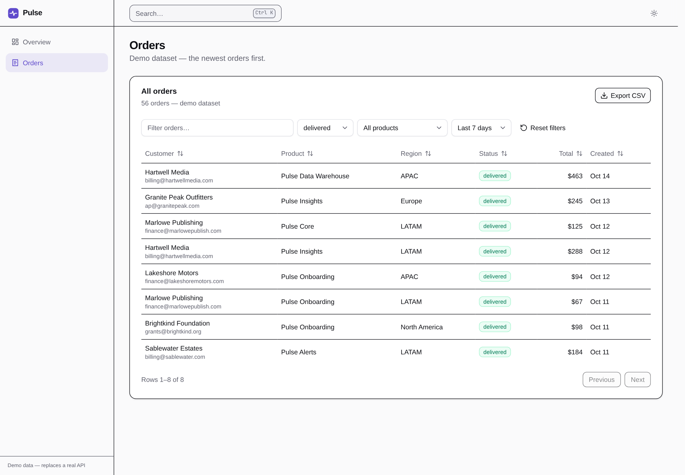
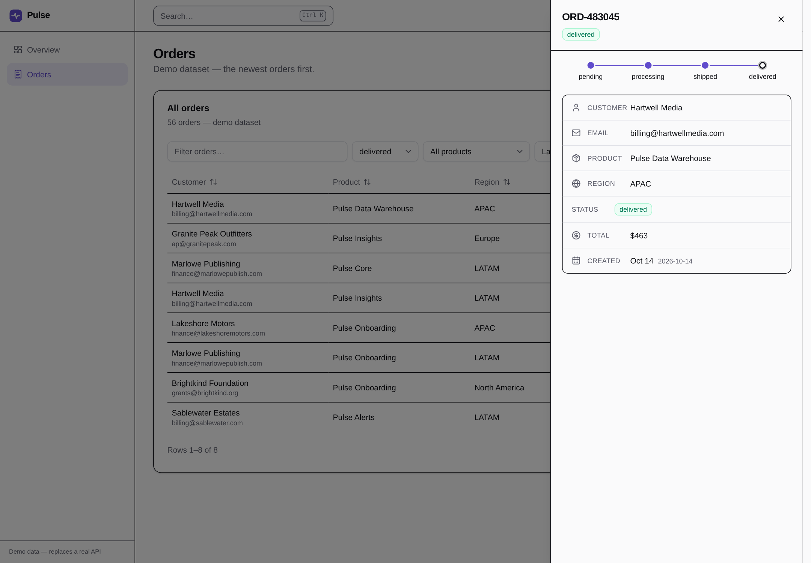
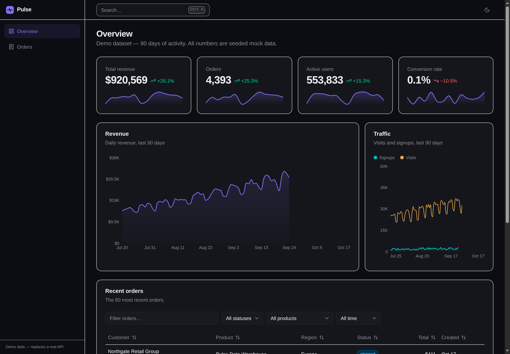

# Pulse

**An analytics dashboard for a fictional SaaS product — a portfolio project that shows real-world frontend craft beyond to-do-list projects.**

React 19 · TypeScript strict · Vite · Tailwind CSS v4 · ShadCN/UI-style primitives · TanStack Table · Recharts · Zustand · React Router · Oxlint

## Demo

Real captures of the running app (headless Chromium, 1440px, device-scale 1.5) live in [`docs/screenshots/`](docs/screenshots/).

| | |
| --- | --- |
|  |  |
|  |  |
|  |  |

More captures (light/dark variants): [`orders-light`](docs/screenshots/orders-light.png), [`palette-open-dark`](docs/screenshots/palette-open-dark.png).

## What's inside

- App shell with responsive sidebar navigation and dark mode (tokens flip via the `.dark` class)
- Command palette built on `cmdk`, wired to real actions (navigation, theming, CSV export, copy-link, filter reset)
- Mock API (`src/data/mock-api`) that simulates ~300ms latency (+ deterministic slow/failing `updateOrderStatus` calls) plus a React Query cache layer (`["dashboard", rangeDays]`) with optimistic status updates, rollback, and retry/error toasts
- Seeded, deterministic dataset: 90 days of revenue/traffic series, range-derived KPIs (7/30/90-day windows vs previous period), and 60 orders
- Overview: 4 KPI cards with a hand-built SVG sparkline (Catmull-Rom smoothing, CSS draw-in animation) plus Recharts area/composed charts
- Orders table on TanStack Table: sortable headers, global + per-column filters (status/product/date-range) persisted in URL search params, pagination, row-detail slide-over, and CSV export of the filtered rows
- Shared ShadCN-style UI primitives under `src/components/ui`

## Roadmap

### M1 — Core UX polish

- [x] Loading/skeleton pass on every data-bound surface
- [x] Empty and error states for all features
- [x] Command palette wired to real actions (navigation, theme toggle)
- [x] README walkthrough GIF *(replaced with real screenshots — see Demo)*

### M2 — Data interaction

- [x] Per-column filters with saved filter state
- [x] Sorting persistence across sessions *(URL search params on `/orders`)*
- [x] Row detail view as a slide-over
- [x] CSV export of the (filtered) table

### M3 — Data layer upgrade

- [x] Replace `mock-api` fetch with React Query and real cache keys (`["dashboard", rangeDays]`, stale-while-warm, 2 retries with backoff)
- [x] Optimistic status updates on orders (cache-wide snapshot + rollback, forward-transition map)
- [x] Retry/error feedback via inline alert + Retry inside the slide-over (deterministic fault injection in `updateOrderStatus` exercises rollback/Retry; sonner stays for app-level toasts, hosted top-layer so they paint over native dialogs)

### M4 — Depth

- [x] Date-range switcher feeding the whole dashboard (`?range=7|30|90`)
- [x] Dashboard-level derived KPIs (`src/data/range.ts`: current vs previous equal-length window)
- [x] Compare-to-previous-period shading in charts (slot-aligned muted dashed line + tooltip delta)

### M5 — Quality

- [ ] Vitest + Testing Library coverage for the table and KPI formatting
- [ ] axe audit fixes
- [ ] Storybook (or Ladle) stories for the UI kit

### M6 — Ship it

- [ ] `prefers-reduced-motion` pass across animations
- [ ] Lighthouse score >= 95
- [ ] README GIF + architecture write-up
- [ ] Deploy to GitHub Pages or Netlify

## Architecture notes

<!-- TODO: expand this section as the data layer matures -->

- The app talks only to `src/data/mock-api`, which simulates ~300ms latency (plus deterministic slow/failing calls) — swap the module for a real client without touching features.
- React Query keys are the `["dashboard", rangeDays]` family: reads and optimistic mutations share one cache slice, so a status write in the slide-over is instantly consistent with every page (and the palette's CSV export reads that same cache first).
- Global UI state is intentionally tiny (theme + palette + drawer in zustand) — server data lives only in the React Query cache.
- Path alias `@` -> `./src`.
- Design tokens in `src/index.css` flip via the `.dark` class, so `var(--chart-1)`–`var(--chart-5)` need no theme-specific chart code.
- Number, currency, and date formatting is centralized in `src/lib/format.ts`.

## Scripts

| Script            | What it does                                    |
| ----------------- | ----------------------------------------------- |
| `pnpm dev`     | Start the Vite dev server with HMR.             |
| `pnpm build`   | Type-check (`tsc -b`) then bundle for prod.     |
| `pnpm lint`    | Run Oxlint across the project.                  |
| `pnpm preview` | Serve the production build locally.             |
